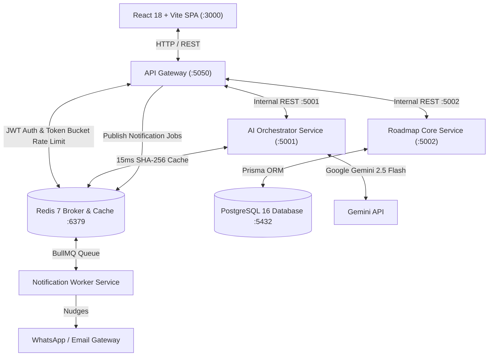
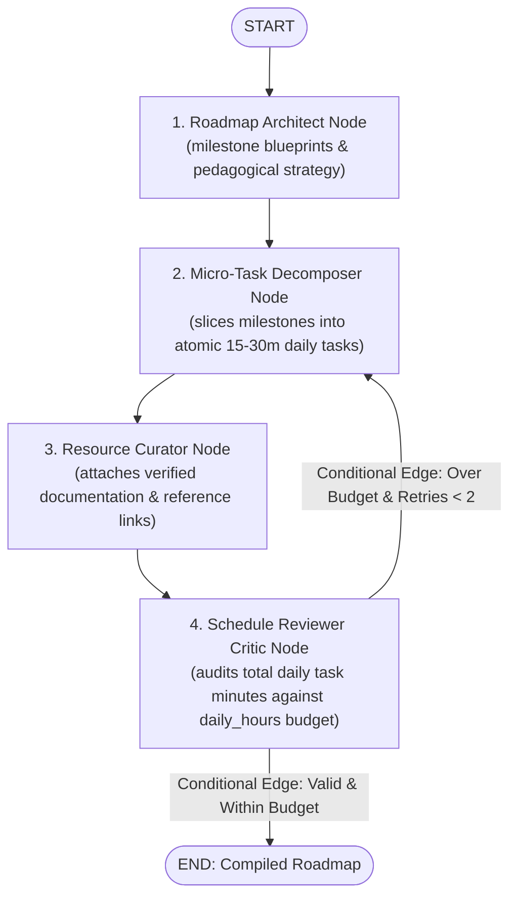

# 🚀 PathPilot AI — Adaptive Agentic Learning Acceleration Platform

> **PathPilot AI** is an adaptive, multi-agent learning acceleration platform engineered for self-taught developers, engineering students, and career switchers. Unlike static roadmaps, PathPilot decomposes complex goals into personalized timelines with atomic 15–30 minute daily micro-tasks, adapts dynamically when learners fall behind, and caches repeated queries in under 15ms.

---

## 🏗️ System Architecture

PathPilot AI is built as a **Distributed Microservices Architecture** designed for high fault tolerance, independent scalability, and clean separation of concerns.



---

## 📦 Microservices Matrix

| Microservice | Port | Stack | Key Responsibilities |
| :--- | :--- | :--- | :--- |
| **`client`** | `3000` | React 18, Vite, Tailwind CSS, React Flow | Interactive visual node trees, daily task checklists, streak trackers. |
| **`api-gateway`** | `5050` | Node.js, Express, Redis | Single reverse proxy entry point, JWT auth, token-bucket rate limiter (10 req/min). |
| **`roadmap-core-service`** | `5002` | Node.js, Express, Prisma ORM, PostgreSQL 16 | Relational persistence (`User`, `Goal`, `Roadmap`, `Milestone`, `DailyTask`, `UserProgress`, `Streak`). |
| **`ai-orchestrator-service`** | `5001` | Python 3.12, FastAPI, LangGraph, Gemini 2.5 Flash | Multi-agent state machine, atomic daily task decomposition, self-correcting critic loops, 15ms Redis caching. |
| **`notification-worker`** | N/A | Node.js, BullMQ, Redis | Asynchronous background reminder queue (`daily_reminder_queue`) delivering email & WhatsApp nudges. |

---

## 🧠 AI Orchestrator Service Deep Dive (`ai-orchestrator-service/`)

The **AI Orchestrator Service** replaces fragile monolithic prompts with a **pure LangGraph State Machine** coordinating specialized agent roles.

### 📐 LangGraph Workflow



### 📂 Directory Architecture

```
ai-orchestrator-service/
├── .env.example                # Sample environment variables
├── requirements.txt            # Locked dependencies (LangGraph, FastAPI, Redis, etc.)
└── app/
    ├── config/
    │   └── settings.py         # Pydantic BaseSettings singleton (12-factor configuration)
    ├── state.py                # GraphState TypedDict (Shared memory across all nodes)
    ├── llm.py                  # Gemini 2.5 Flash provider + ainvoke_structured_llm helper
    ├── router.py               # Conditional edge routing logic (route_after_review)
    ├── graph.py                # StateGraph workflow assembly and compilation
    ├── schemas/                # Pydantic input/output contracts
    │   ├── request_schema.py   # GoalRequest & ReAdaptRequest (with camelCase aliases)
    │   └── roadmap_schema.py   # TaskSchema, MilestoneSchema, RoadmapSchema
    ├── prompts/                # Modular, versioned prompt templates
    │   ├── architect_prompt.py # Milestone blueprint generation prompt & schema
    │   └── decomposer_prompt.py# Atomic 15-30 min task prompt with critic feedback injection
    ├── nodes/                  # Pure LangGraph processing nodes
    │   ├── architect_node.py   # Formulates milestone blueprints and curriculum summary
    │   └── decomposer_node.py  # Deconstructs milestones into daily micro-tasks
    └── services/
        └── redis_cache.py      # Deterministic SHA-256 query caching (<15ms cache hits)
```

### ⚡ Key Engineering Highlights

1. **Self-Correction Feedback Loop**:
   - The Reviewer node acts as an in-graph Critic. If the total task duration for any day exceeds the learner's `daily_hours` budget, the conditional edge routes execution back to the Decomposer node with actionable diagnostic guidance.
2. **In-Memory Circuit Breaker**:
   - The shared `GraphState` tracks `retry_count`. Retries are hard-capped to 2, ensuring bounded API spend and preventing infinite loops.
3. **Sub-15ms Redis Caching**:
   - Goal requests generate a deterministic SHA-256 signature (`title:target_days:daily_hours:skill_level`). Duplicate queries bypass LLM inference entirely and return cached roadmaps in under 15ms.
4. **Relational Schema Alignment**:
   - Output schemas map 1-to-1 with PostgreSQL Prisma entities (`Milestone`, `DailyTask`), eliminating data-mapping bugs when transmitting payloads to the Core Service.

---

## 🛠️ Quickstart & Local Setup

### Prerequisites
- Docker & Docker Compose
- Node.js 18+ & npm
- Python 3.12+

### 1. Start Infrastructure (PostgreSQL & Redis)
```bash
docker compose up -d postgres-db redis-broker
```

### 2. Run Roadmap Core Service (:5002)
```bash
cd roadmap-core-service
cp .env.example .env
npm install
npx prisma migrate dev --name init
npm run dev
```

### 3. Run AI Orchestrator Service (:5001)
```bash
cd ai-orchestrator-service
python3 -m venv .venv
source .venv/bin/activate
pip install -r requirements.txt
cp .env.example .env
# Add your GEMINI_API_KEY in .env
uvicorn app.main:app --host 0.0.0.0 --port 5001 --reload
```

---

## 📄 License
MIT License. Built with ❤️ for developers accelerating their mastery.
